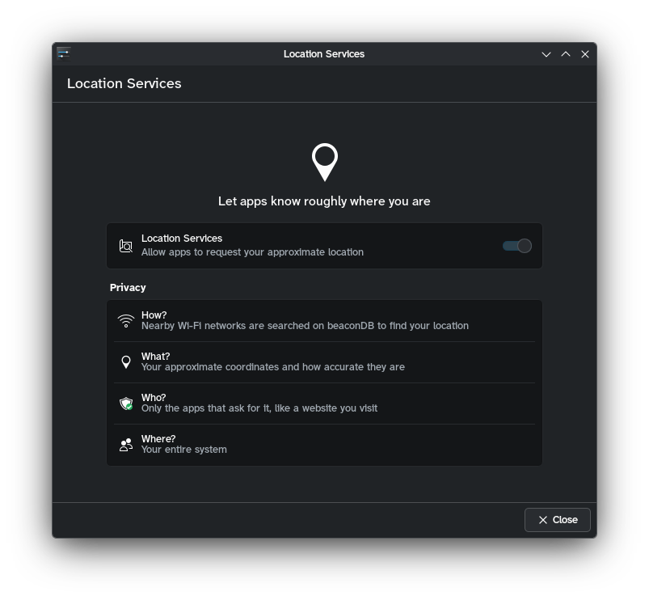

# Location KCM

for some reason plasma doesn't have a location services settings page, so i made one. it adds **Security & Privacy → Location Services** to system settings: one switch that lets apps ask geoclue for the device's approximate location, or stops them. geoclue looks the location up on beaconDB (we can't use mozilla location services because it's dead now btw).

plasma might get its own switch eventually. [plasma-workspace!5434](https://invent.kde.org/plasma/plasma-workspace/-/merge_requests/5434) only sets a manual position, and the design is still being discussed in [systemsettings#44](https://invent.kde.org/plasma/systemsettings/-/work_items/44). once plasma ships one, drop this KCM.

## how it works

geoclue gets started over D-Bus whenever an app asks for it, so disabling `geoclue.service` does nothing. turning location off masks it instead. taidan's slint rewrite ([`slint` branch](https://github.com/Ultramarine-Linux/taidan/tree/slint), not on `main` yet) masks it the same way when you turn location off during setup, so both agree on the state. masking is also what [KDE bug 515145](https://bugs.kde.org/show_bug.cgi?id=515145) suggests plasma checks to grey out night light's and the time zone's automatic location.

### reading the state

the KCM asks systemd over D-Bus with `GetUnitFileState("geoclue.service")`, which doesn't need authentication. `masked` and `masked-runtime` mean off, anything else (normally `static`) means on.

a missing unit means geoclue isn't installed. systemd 259 answers `org.freedesktop.DBus.Error.FileNotFound` for that, and `org.freedesktop.systemd1.NoSuchUnit` is accepted too. a `bad` unit file or any other error shows an error with a Try Again button instead of claiming geoclue isn't installed.

### changing it

the switch runs `pkexec /usr/libexec/ultramarine-location-helper enable|disable`. the helper ([`kcm-location/data/ultramarine-location-helper.in`](../kcm-location/data/ultramarine-location-helper.in)) is a tiny root shell script that only accepts those two words:

- `disable` runs `systemctl mask --force --now geoclue.service`, so apps that already have a location stop getting updates too
- `enable` runs `systemctl unmask` and `systemctl unmask --runtime`, so a mask in either `/etc` or `/run` goes away

its polkit action, `org.ultramarine.location.manage`, matches the helper's exact path and is `auth_admin_keep`, so you only get asked for your password once. pkexec's 126 and 127 mean auth was canceled or failed and nothing changed (the helper never exits with those itself). any other failure says the change might've been partly applied. the KCM reads the state again after every change.

the helper's path follows the install prefix. set `-DULTRAMARINE_LOCATION_HELPER=...` to change it, and the polkit action gets generated with the same path.

this is system-wide, for every user. GNOME has its own per-user switch (`org.gnome.system.location`), which this doesn't touch.

## runtime requirements

- `geoclue2`, otherwise the page says location services aren't installed
- systemd, `pkexec` and a polkit authentication agent
- `kirigami-addons`, since the page uses `org.kde.kirigamiaddons.formcard`. packaging has to `Require` it
- the helper and its polkit action in `libexec` and `share/polkit-1/actions` under the install prefix. polkit only reads actions from `/usr/share/polkit-1/actions`, so with any other prefix pkexec falls back to its generic `org.freedesktop.policykit.exec` prompt (and doesn't remember your authorization). copy or link `org.ultramarine.location.policy` into `/usr/share/polkit-1/actions` in that case. CMake warns about this when the prefix isn't `/usr`
