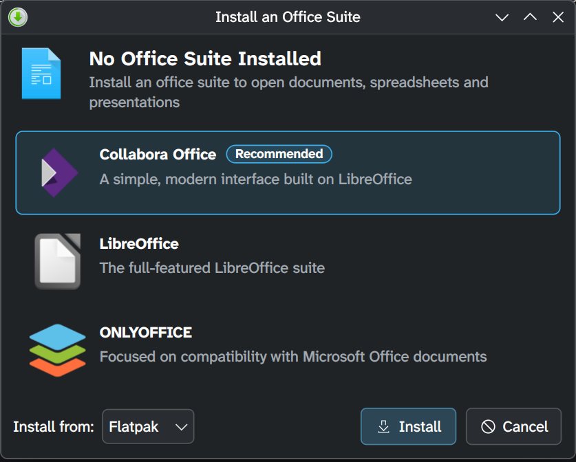

# Office app installer

since we decided to remove the default office suite, we wanted a popup that tells users which office suites are available and offers to install one. i was able to do this in a way i think is pretty elegant.

the `.desktop` file lists all of the office file MIME types and runs the installer. it's `NoDisplay`, so it doesn't show up in launchers. office apps *should* take precedence over the installer for those MIME types once they're installed, but even if they don't, the installer looks for other apps that handle the MIME type and passes the file along to those.

here's what it looks like:



it offers:

- **Collabora Office** (recommended): flathub, or Terra's RPM (`collabora-office`)
- **LibreOffice**: flathub, or fedora's RPMs (`libreoffice-writer`, `-calc`, `-impress`)
- **ONLYOFFICE**: flathub only

flathub is always the default. RPMs aren't offered on image-based (bootc or rpm-ostree) systems, where `/run/ostree-booted` exists. each suite's icon comes from the appstream data flatpak already keeps in `/var/lib/flatpak/appstream` (or the user installation's), so nothing gets downloaded just to show the dialog. without appstream data it falls back to a document icon.

## how it works

### the handler

[`office-installer/data/org.ultramarine.OfficeInstaller.desktop.in`](../office-installer/data/org.ultramarine.OfficeInstaller.desktop.in) handles ODF, OOXML, legacy microsoft office, iWork and WordPerfect files and runs `/usr/libexec/ultramarine-office-installer %U`. formats that are also plain text (CSV, RTF, flat ODF) are left out, so they still open in a text editor.

file managers' **Open With** menus list every handler, `NoDisplay` or not, so it shows up there as **Office Suite Installer** even with a suite installed.

### once a suite is installed

KF6 ignores `InitialPreference`. handlers that aren't in a `mimeapps.list` all have the same preference and KService sorts them by desktop file name, so `org.ultramarine.OfficeInstaller` comes after `com.collaboraoffice.*`, `libreoffice-*`, `org.libreoffice.*` and `org.onlyoffice.*`. fedora's `mimeapps.list` also makes `libreoffice-*.desktop` the default.

when the installer still gets picked (a suite that sorts later, like WPS, or GIO, which doesn't rank handlers), it looks for another app that lists the document's MIME type itself and quietly opens the document there. parent types don't count: a `.docx` is a zip, but ark isn't an office suite.

### a suite that can't open the file

ONLYOFFICE doesn't open everything the installer claims (microsoft works, WordPerfect, ODF charts, master documents and HTML templates). if something opens DOCX, ODT, XLSX, ODS, PPTX or ODP, a suite is installed, so the dialog says that suite can't open this file and offers the others.

### installing

flatpaks install from the `flathub` system remote with libflatpak (`app/<id>/<arch>/stable`), and RPMs go through packagekit's D-Bus API (`Resolve`, then `InstallPackages` with only trusted packages). both authorize through polkit, which asks non-admins for an admin password in the session. wheel users install flatpaks without a prompt (fedora's `org.freedesktop.Flatpak.rules`).

why not just shell out to the CLIs? `flatpak install -y`, `--noninteractive`, `pkcon -y` and `pkgcli -y` all mark the transaction non-interactive, so polkit refuses with "Not authorized" instead of asking. without `-y` they ask their own questions on a terminal, which a GUI doesn't have.

the D-Bus enum numbers are packagekit 1.x's (its main branch renumbers them), so the installer checks the daemon's `VersionMajor` and refuses anything else.

### canceling

**Cancel** stays available while installing. it cancels the libflatpak or packagekit transaction and the dialog goes back to the suite list. before packagekit's transaction starts, it stops right away. the dialog only says the install was canceled when it actually was: if packagekit or libflatpak refuses and then fails for another reason, you see that reason.

flatpak only deploys an app once it's fully downloaded, so a canceled install leaves at most some downloaded data behind. packagekit refuses to cancel once it's installing the RPMs, so then the install finishes and the documents open.

### afterwards

the installer refreshes KSycoca and opens the documents with the new suite. if KSycoca doesn't know about the suite yet, it runs it directly (`flatpak run --file-forwarding`, `coda-qt` or `libreoffice`). if an app fails to start, you see the error instead of the installer quietly quitting, and trying again only reopens the documents that didn't open.

it only quits once the apps have started. closing the dialog while it says "Opening…" just hides it until then (and brings it back if an app failed).

### errors

install failures show packagekit's or libflatpak's reason. packagekit sometimes only gives an exit code, so the installer explains those itself: a repo whose signing key isn't trusted yet (named from `RepoSignatureRequired`), packages that aren't signed with a trusted key, or another transaction that took priority.

errors libflatpak marks non-fatal (translations, GL extensions) show up as progress and don't abort the install.

### one at a time

the dialog exports its `addDocuments` method, then takes `org.ultramarine.OfficeInstaller` on the session bus. opening more documents while it's open hands them over, so they open with whatever suite it installs and two installs can't run at once. it gives the name up once it starts opening documents or closes, so later launches get their own dialog instead of handing documents to one that'll never open them.

## packaging

everything is in the `ultramarine-office-installer` CMake component. building needs `flatpak-devel`. at runtime it needs `flatpak-libs` (pulled in by the soname) and `PackageKit` (the daemon, not `pkcon`), and flathub has to be set up as the `flathub` system remote.

## testing

```bash
just build
build/bin/ultramarine-office-installer ~/Documents/report.docx
```

with a suite installed, that opens the document in it. run it without a file to always get the dialog.
