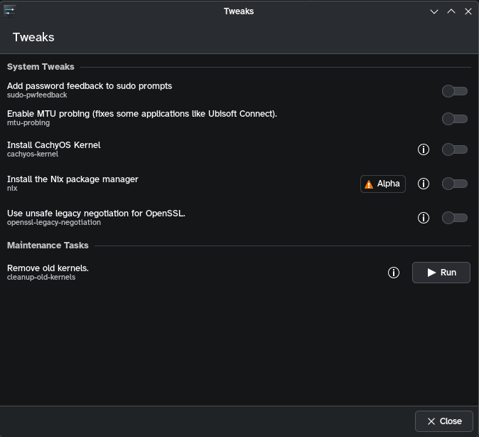

# Tweaks KCM

the tweaks KCM is a frontend for umcli. it has `um` list the available tweaks as JSON and uses umcli directly as the backend, with no separate backend layer. updates are handled by [`ultramarine-updates`](updates-backend.md) instead.

the frontend is really simple. it's a dynamic `ScrollViewKCM` that grows new rows as tweaks get defined in umcli, so we don't need to touch the KCM to add tweaks unless the manifest format changes.

## how it works

### listing

whenever the page is shown, it runs `um tweaks list --json`. each directory in umcli's tweak data becomes a row, and tweaks with known types (`toggle`, `oneshot`, `script`) show up without any KCM changes. unknown types get listed without a control.

whether a tweak is on comes from umcli. a tweak's `check.sh` decides if it has one, so the KCM can tell when a tweak was already enabled some other way. the world-readable markers under `/var/lib/um/tweaks/` are the fallback when there's no `check.sh` (or it exits with "unknown"). if the check fails, um sets `state_error`, and the KCM shows the state as unknown with the error and won't let you change that tweak from there.

the JSON has a `version`. the KCM only accepts version 1 (or no version, from um builds before it was added) and asks for a newer system settings otherwise, since a new version might change what the fields mean. a `version` that isn't a positive whole number gets its own error.

### changing tweaks

enabling, disabling or running a tweak runs `um tweaks`, which escalates through polkit for anything that needs root. risky or irreversible tweaks show a warning first.

um gets started without stdin and in its own session, so it never sees a terminal and escalates through pkexec (on qt 6.6, which has no `CreateNewSession`, the KCM calls `setsid()` in the child itself). the exception is a `wheel` user that sudo doesn't need a password for (a `NOPASSWD` rule or cached credentials). um then uses `sudo -n`, which forwards the `UM_*` overrides and exits 1 rather than 126 or 127 if it fails.

um exits with pkexec's 126 or 127 when auth was canceled or failed. it maps a playbook's or script's own 126 and 127 to 1, so those codes always mean nothing changed.

### closing the page

um leads its own session and process group, so closing the page while the list is loading kills the whole group and the `check.sh` scripts don't outlive it.

a running change can't be canceled from the KCM, since once um runs as root, the unprivileged KCM can't signal it. closing the page or system settings leaves it running instead of killing it halfway. its output goes to a `0600` file in `$XDG_RUNTIME_DIR` (unlinked as soon as um starts, then polled by the KCM) instead of a pipe, because go kills a program that writes to a closed pipe on stdout or stderr. um is also started with SIGPIPE ignored.

## runtime requirements

- umcli with [um#26](https://github.com/Ultramarine-Linux/um/pull/26), which adds `um tweaks list --json` (with `state_error`), the polkit action and pkexec escalation without a terminal. it isn't merged or released yet, so no released umcli works with this KCM. older um releases get a "too old" message instead of a list
- kirigami and KCMUtils' QML modules. unlike [location](location.md), this page doesn't need `kirigami-addons`
- `/usr/bin/um` and `/usr/share/um` from the `umcli` package. `-DUM_EXECUTABLE=...` can point development builds elsewhere. if that path doesn't exist, the KCM falls back to the first `um` in `PATH`, which works, but polkit then uses its generic `org.freedesktop.policykit.exec` action (generic prompt, no remembered authorization) instead of umcli's
- umcli's polkit action at `/usr/share/polkit-1/actions/org.ultramarine.um.policy`. the KCM runs `um` as the logged-in user, and umcli re-executes through `pkexec` when it needs root
- `pkexec` and a running polkit authentication agent. `pkexec` clears the environment, so um refuses to escalate through it while `UM_TWEAKS_PATH`, `UM_DATA` or `UM_STATE` is set, instead of silently using the installed `/usr/share/um` data. the KCM shows that error

for how the commands themselves behave, see the [umcli README](https://github.com/Ultramarine-Linux/um/blob/main/README.md).
